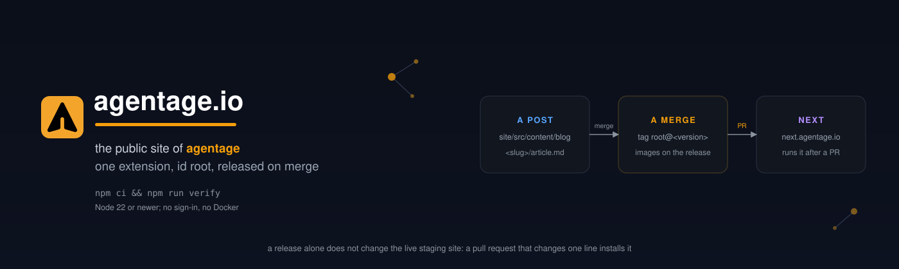

# agentage.io



The public site of agentage. Visitors read the blog and join the waitlist. Clients and MCP registries read its discovery documents. The site runs on the staging estate "next", not yet in production. It is one extension with the id `root`; its package `@agentage/extension-root` is private and never goes to npm.

## Quick start

You need Node 22 or newer and npm 10 or newer. The checks need no Docker and no sign-in.

```bash
npm ci
npm run verify                    # type-check, lint, format, build, tests with coverage
npx agentage extension check      # PASS root <version> conforms (6 rules)
```

## What is in this repo

| Path                | What                                                                              |
| ------------------- | --------------------------------------------------------------------------------- |
| `site/`             | the Next.js site; `scripts/export-site.mjs` exports it to static files            |
| `site/src/content/` | content as data: blog posts at `blog/<slug>/article.md`                           |
| `src/api/`          | the api part: `/api/root/subscribers` and two `/.well-known/` documents           |
| `migrations/`       | the store part: postgres, the `subscribers` table                                 |
| `openapi.json`      | every api route; generated, never edit by hand                                    |
| `docs/`             | [docs/develop.md](docs/develop.md): routes, what `up` starts, the site, the words |

The three parts are pages (the exported site), api and store.

## How content is added

To add a blog post, create `site/src/content/blog/<slug>/article.md` with the front matter of an existing post. Put its images in `site/public/blog/<slug>/images/`. Quote YAML dates. Open a pull request. A merge publishes the post: it is a change to real content, so it releases a new version of the site.

## How to work on it

```bash
npm ci
mkdir -p .agentage && cp secrets.example.json .agentage/secrets.json   # resend "off" sends no mail
npx agentage extension up --docker    # needs Docker; ports 4280 and 4281 free; serves localhost:4280
npx agentage extension down           # removes the containers, network and volume
```

An api call needs a token: `T=$(npx agentage extension token --scope root:admin)`. Details and routes: [docs/develop.md](docs/develop.md). Coverage must stay at 70 percent or more.

## How a change is released

A merge to master is the release. `release.yml` runs `agentage extension release --changed`. When real content changed since the last `root@*` tag, it makes a date version `YYYY.MDD.N`, the tag `root@<version>`, the part images and the one image, and attaches `agentage-extension.json` and `agentage-container.json` to the GitHub release. Nothing goes to npm. A released version never changes: a fix is a new merge.

A change to a root-level `*.md` file, to `docs/` or to `.github/` releases nothing. A blog post under `site/src/content/` does release. A release installs on next only when a pull request in the estate raises the version of the `root` row.

## For agents

```bash
npm ci && npm run verify && npx agentage extension check
```

- Required CI check: `ci-required`. The rules and the traps are in [CLAUDE.md](CLAUDE.md) (`AGENTS.md` links to it).
- Never tag, publish or release by hand. Never edit `openapi.json` by hand: run `npx agentage extension check --write`.
- Run `extension up` only when you accept that it starts containers on ports 4280 and 4281.

## Related

- [agentage/kit](https://github.com/agentage/kit): the kit `@agentage/extension` that runs the parts.
- [agentage/examples](https://github.com/agentage/examples): the probe, an example of the same shape.
- [agentage/cli](https://github.com/agentage/cli): the `agentage` command.

## License

MIT. See [LICENSE](LICENSE).
